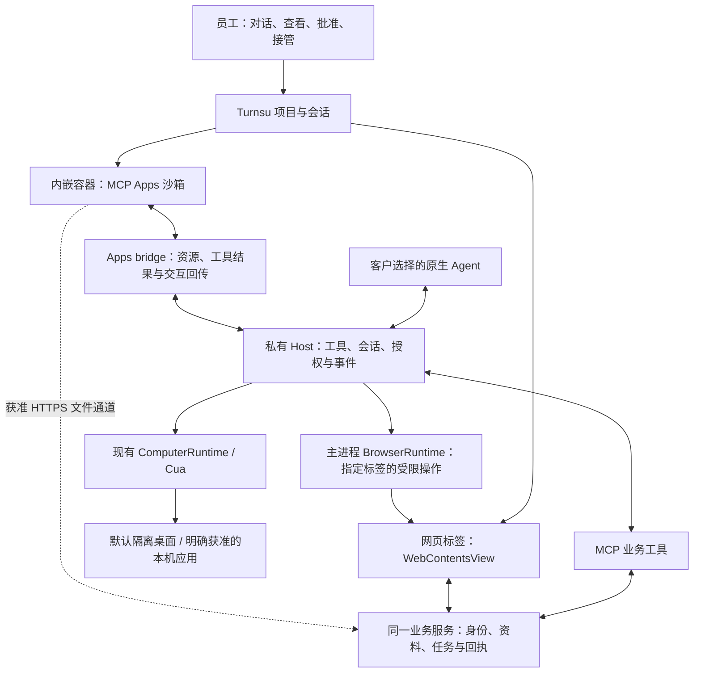

# 下一版：内置浏览器、Browser Use、CUA 与 Intelligence UI

调研日期：2026-10-14。状态：**技术方向已获用户确认，尚未实施或验收**。后续以[实施计划](next-workbench.md)和[组件评审](ui-components.md)推进，组件及样式需先由用户确认。以下保留本次调研的资料和版本快照：核对官方资料、本机应用包和源码，不安装竞品或 REA，不操作客户账号。

本文补充下一版的浏览器与交互宿主设计。[既有能力计划](capabilities.md)中的多 Agent、文件能力、默认隔离的电脑操作、本机定时及权限边界继续有效。本文没有替换产品定义或开发约束。

版本必须分开看：远端 `main` 当前为 `971fe8e67403b65fe96157499557fb3611300e16`；本机能力分支 `codex/workbench-capabilities` 为 `d064749c6c684ba752bceada1799f0c3b275298b`。下文提及已有 Cua、工具桥和定时能力，指**能力分支**，不能当作 main 已交付。

## 产品说明：给人阅读

### 1. 结论与用户价值

建议保留现有 Electron 底座，增加真正的内置浏览器和 MCP Apps 宿主，并把 Browser Use 与已有 CUA 接入同一套项目、授权、执行记录和资源管理。它们供客户选定的 Agent 使用，不再另建两个独立推理系统。

员工应该能完成这一条路径：**在工作台提出任务 → 选材料或打开业务网页 → 在交互界面补充和核对 → 授权 Agent 操作 → 接管有疑问的步骤 → 查看已保存资料、结果文件或业务回执 → 重开继续。**

| 能力 | 员工能做什么 | 不应混淆的边界 |
| --- | --- | --- |
| 内置浏览器 | 在任务旁打开网页、登录、查资料、查看本地应用；与 Agent 接力 | 页面打开，不表示 Agent 已获操作权限 |
| Browser Use | 让所选 Agent 读取、点击、填写指定网页，并核对结果 | 不能因为装了浏览器就默认开放所有网站、账号和上传 |
| CUA | 操作获准的桌面应用或隔离桌面，处理网页之外的步骤 | 浏览器操作成功，不等于系统文件选择器或其他应用已通过验收 |
| Intelligence UI / MCP Apps | 在对话里改表格、选照片、填任务要求、核对差异；必要时展开到大工作面 | 需要真实的宿主与 Agent 回传，普通网页预览不能替代 |

Intelligence UI 确实需要能运行 HTML/JS 的隔离环境，但**不必依赖带地址栏的通用浏览器**。对话内 App 和普通网页应是两个入口，共用业务数据；不要先把交互全部做成网页，再把“网页打开了”当作聊天集成完成。[MCP Apps 官方说明](https://modelcontextprotocol.io/extensions/apps/overview)

### 2. 三款产品实际采用什么方案

以下分别记录官方产品行为与本机静态实现线索。包内存在某条代码路径，不证明当前账号已启用，也不证明所有平台采用相同路径。

| 产品 | 官方能够确认的行为 | 本机包内能够确认的实现 | 对 Turnsu 的启发 |
| --- | --- | --- | --- |
| Codex / 当前 ChatGPT 桌面 | 内置浏览器与对话并排或全屏；独立浏览器资料；也能通过扩展使用外部浏览器；有站点、下载及开发者访问控制 | Electron；浏览器页面用 `<webview>` 创建；另有浏览器会话注册、页面挂载代次、挂载/销毁消息与标签预算管理 | 人和 Agent 共享同一个页面；页面所属任务、授权和生命周期都是宿主职责 |
| Claude / Cowork | 桌面侧栏内置浏览器，与 Claude in Chrome 扩展是不同入口；可在站点登录，按用户选择复用登录资料 | Electron；网页/文件预览存在 `WebContentsView`、独立 session 和 CDP 工具代码；有 Chrome MCP 与 Computer Use 模块 | 学习网页、资料和任务并排的体验；**未把 Cowork 新内置浏览器的完整执行链定位完，不能把预览实现直接当作它的全部架构** |
| WorkBuddy | 任务右侧承载产物、文件和浏览器；多标签、持久登录、账号隔离与清除浏览数据 | Electron；`<webview>`；应用级会话浏览器保活；内部 DOM 操作经受控 CDP；另有浏览器 runtime 与 MCP Apps Host | 浏览器应属于任务工作面；用户操作、Agent 操作、产物和回传要接在一起 |

来源：[OpenAI Browser](https://learn.chatgpt.com/docs/browser)、[Claude 内置浏览器](https://support.claude.com/en/articles/16607400-use-the-built-in-browser-in-claude-cowork)、[WorkBuddy 右侧边栏](https://www.workbuddy.cn/docs/workbuddy/From-Beginner-to-Expert-Guide/Function-Description/Right-Sidebar)。静态样本的版本、定位和哈希见[第 10 节](#10-本次证据与限制)。

不能照搬的地方：Codex、WorkBuddy 的本机样本确有 `<webview>`，但 Electron 官方目前提示其渲染、导航和事件路由存在架构变化，建议考虑其他方式。Turnsu 是新接入，优先采用主进程拥有的 `WebContentsView`；这属于基于现有底座和官方建议的选择，不是宣称竞品实现错误。[Electron webview 提示](https://www.electronjs.org/docs/latest/api/webview-tag)

### 3. 下一版应该长什么样

2026-10-14 范围澄清：本节是容器接入建议，不授权重做整套工作台 UI。正式要求是在现有工作台增加内嵌浏览器，把 Intelligence UI 能力装入其中；组件、Browser Use/CUA、文件和任务回传按[实施计划](next-workbench.md)接线。对话内交互可复用，但不是用来替代内嵌入口。

保留“项目/会话—对话—按需工作面”的简洁结构。用户不用先在 CUA、Browser Use、MCP 之间做技术选择。

- **内嵌容器承载任务交互**：资料卡、补件、字段、表格、照片、确认与回执在容器内按任务组合。对话卡可复用摘要或短交互；展开、收起与重开仍绑定同一任务和同一份草稿，不新建第二份数据。
- **工作面提供浏览器标签**：地址、前进/后退、刷新、加载/失败、当前账号配置、执行位置、谁在操作。保留系统浏览器打开入口；标签归属任务，但登录资料不应每个会话重建。
- **Agent 操作可见且可接管**：显示“等待你登录”“Agent 正在操作”“已暂停”“结果待核对”；接管即停止后续自动输入，归还时重新读取页面。停止不等于撤销已经提交的订单或消息。
- **文件操作与页面结合**：人工选文件、允许 Agent 上传、下载到项目是不同动作。上传显示选定范围和目的地；下载完成并校验后再登记成果。不要把文件内容或签名上传地址塞进聊天历史。
- **账号与客户隔离**：用户明确选择工作账号配置；不同客户不共享 Cookie、网页缓存或授权。默认不导入个人浏览器的全部登录资料。

三个首批场景足以检验通用性：

1. 客服：主动导入微信桥材料 → 核对对话和附件 → 在获准网页查订单 → 生成回复草稿 → 员工确认后通过获准渠道发送。没有订单接口或发送权限时，停在可核对的草稿，不能显示已处理/已发送。
2. 运营：选择 Excel 和多张照片 → 在 Intelligence UI 修改资料 → 提交选定材料及任务要求 → 查看任务进度与逐项回执。保存、云端接收、业务完成分别显示。
3. 行政：打开已登录的内部系统 → 浏览器 Agent 填写表单 → 人工核对并提交 → 下载 PDF 到项目。遇到系统弹窗或桌面软件，经过明确授权才转 CUA。

### 4. 沙盒、云端和内存的决定

**四种隔离不能混称一种。** Chromium 页面沙箱用于限制网页；浏览器 profile 用于分开登录和缓存；MCP App 沙箱用于隔开第三方交互界面；容器/虚拟机用于隔开电脑执行环境。profile 独立不等于任务已在虚拟机中执行。

已确认的“电脑操作默认隔离”保留。用户手动打开内置网页或使用 MCP App，不必因此启动整个隔离桌面。Agent 要操作本机内置浏览器时，必须明确选择该执行位置并获准；默认隔离任务不可悄悄改到本机。隔离任务也要有可看的执行画面和接管入口，实际画面通道及控制链须在第一轮技术验证中证明。

**内置浏览器可以与 Turnsu 云端交互。** 普通页面通过受认证的 HTTPS 接口上传/提交；MCP App 通过获准工具或声明过的网络域名交互。两种入口调用同一业务服务，云端身份与操作权限仍由服务端检查。允许连接域名、浏览器 CORS 放行都不能替代身份验证。[MCP Apps CSP/CORS](https://github.com/modelcontextprotocol/ext-apps/blob/main/docs/csp-cors.md)

本机静态检查发现 WorkBuddy 的会话浏览器在切换时隐藏保留，在关闭或收到淘汰事件时才卸载。**这是一条值得验证的内存驻留机制，不是已复现的泄漏根因。** 它的官方更新日志也记录过本地助理内存增长与浏览器后台资源的修复；不能据此判断用户当前版本的问题已经解决。[WorkBuddy 更新日志](https://www.workbuddy.cn/docs/workbuddy/Changelog)

Turnsu 的取舍应是：聊天历史只恢复索引；标签只恢复名称、地址和归属；打开时才创建页面；闲置可回收，但正在输入、上传、运行、等待批准的页面要保护。未保存的外部网页表单不能保证可重建，回收前需提示或保持，达到预算时排队，不能为省内存丢工作。

### 5. 建议迭代顺序与完成证据

以下是调研形成的实施顺序，当前以已确认方向的[实施计划](next-workbench.md)为准；组件与样式仍待用户确认。这不是本次完成清单，也不取消之前未完成的跨平台验收。

| 顺序 | 应交付的可用路径 | 必须看到的证据 |
| --- | --- | --- |
| A：浏览器及宿主最小真实路径 | 一个网页标签 + 一个真实 MCP App；人工登录、文件选择、表格修改、保存、回到同一 Agent 继续 | 当前真实宿主中出现 App；数据库重读有修改；Agent 下一回合读到本次版本；无第二套演示 Host 代替 |
| B：Agent 操作与接管 | 当前选定 Agent 操作指定网页；默认隔离 CUA 与获准本机操作分别可用 | 真正点击/填写后页面结果；接管后不再有延迟点击；停止、撤权、重开和结果未知可恢复 |
| C：业务资料与云端任务 | 同一交互资源可内联或展开；选定文件上传、任务提交、进度和回执贯通 | 服务端已保存的文件/任务 ID；刷新后一致；重复提交不重复启动；对话同步失败不重复提交业务任务 |
| D：客户版收口 | 多 Agent 兼容、Windows/macOS 可见交互、长时使用和升级 | 对应平台与真实 Agent 的证据；完整进程组及虚拟化开销；原数据仍在；不能只以打包/CI 成功通过 |

先用我们可控的业务服务和授权样本证明通用路径，客户专属系统再按插件/Skill 适配。未接通真实系统时，界面明确“未接入”，不以模拟业务回执交付客户。

## 实现与验收：给 Agent 和开发者

### 6. 现有实现的差距与复用点

| 当前入口 | 核对结果 | 下一版职责 |
| --- | --- | --- |
| `apps/desktop/electron/main.mjs:215` | 当前能力分支只有工作台 `BrowserWindow`；拒绝页面导航、弹窗和挂载 webview | 保留工作台安全边界；新增独立拥有的浏览器页面，不放开整个 UI 的导航权限 |
| `packages/agent-host/computer-runtime.mjs` | 有 Driver 生命周期、隔离容器、本机模式、授权检查、退出清理及隔离浏览器准备 | 复用 CUA 执行链；补可见控制面，不重复启动每个 Agent 自己的 Driver |
| `packages/agent-host/tool-broker.mjs` | 私有 socket/pipe 与每会话 token；目前调度文件与电脑工具 | 增加受控网页工具及 App 事件，继续核对项目、会话和授权 |
| `packages/agent-host/tool-mcp.mjs:20` | 只实现 initialize、ping、tools/list、tools/call；返回普通 content，未保留完整 `_meta`、structuredContent，也没有资源读取 | 实现工作台拥有的 MCP/App 客户端链路；不能把现有工具端点改个名称就称作 Apps Host |
| `packages/agent-host/host.mjs:264` | Codex 动态工具只映射名称、描述、输入 schema | 宿主独立保留工具来源和 UI 资源；不同原生 Agent 的协议继续在适配器内处理 |
| Intelligence UI `src/server.ts` | 有 `present_ui/show_view`、`ui://` 资源、Apps 元数据，当前网络域名清单为空 | 复用组件与契约；按实际授权开启网络，不能默认全部可访问 |
| Intelligence UI `src/ui/host.ts:136` | 自建 AppBridge 的 context/message 回调目前只是写入网页日志 | 换成 Turnsu 的实际会话事件和上下文消费；日志显示成功不等于 Agent 接收 |

关联任务为“开发通用 Intelligence UI MCP”（`01a13644-bcca-73d3-b12d-c20c1d6d362b`）。该组件项目支持对话内与内置浏览器入口，必须涵盖文件、任务要求与云端交互；本工作台按用户最新要求以内嵌浏览器承载能力。跨仓库实现参考其 `docs/intelligence-ui-end-to-end-plan.md`；此处不修改该项目。

### 7. 组件与控制链



浏览器执行组件是 Electron 主进程内的受限模块，不新建一个通用编排服务。私有 Host 持有任务权限与索引，主进程持有实际 WebContents。原生 Agent 使用现有接入方式，不能直接拿到任意调试端口或主进程对象。

#### 7.1 页面承载技术选择

| 选项 | 本轮建议 | 原因与需验证的代价 |
| --- | --- | --- |
| `WebContentsView` | 通用网页首选 | 主进程拥有页面/会话/导航；适合侧栏或全屏。需要处理尺寸、焦点、原生视图遮挡、弹窗与销毁，不能当普通 React div |
| sandbox iframe + AppBridge | 容器内 MCP App 首选 | 在内嵌浏览器的受控宿主页中承载组件；独立 origin、CSP、消息验证与资源加载由宿主落实。网页 API 调用和模型上下文不是自动连通 |
| Electron `<webview>` | 不作为新实现默认选择 | 竞品已有大量挂载/保活治理；官方明确提示稳定性风险。只有第一轮验证证明替代方案阻断核心路径时再比较 |
| 单独 Chromium / 外部浏览器 | 隔离任务或已登录外部浏览器的明确入口 | 保留对应授权与资源开销；不为每个 Agent 起一份，不暗中导入客户资料 |
| WKWebView / WebView2 / CEF 重建底座 | 当前不选 | 现有 Electron 已能承载核心路径；此时更换底座增加平台与工具连接的验证面，尚无当前验收收益证明 |

[WebContentsView 官方 API](https://www.electronjs.org/docs/latest/api/web-contents-view)和[Electron 安全要求](https://www.electronjs.org/docs/latest/tutorial/security)是实现依据。页面禁用 Node，启用 context isolation、sandbox 和 web security；没有通用 `host.command` 或完整 Electron API 可供网页使用。导航、弹窗、下载、权限请求都由宿主核对目标，禁止为兼容网站关闭证书检查或 web security。

普通网页不授予工作台 preload。可信 UI 的 IPC 也必须检查 sender、页面身份与 payload。上传通过用户选定文件或单次文件授权，不允许网页传任意本机路径。企业代理、证书与 SSO 不兼容时给出可诊断错误和人工/外部浏览器入口。

#### 7.2 Browser Use 与 CUA 的分工

工具暴露“列出获准标签、读取页面、导航、点击、输入、截图、文件传输、停止”等小接口。宿主内部可用 CDP 实现指定 WebContents 的操作，但不向模型直接开放任意 CDP、JavaScript 执行或 Cookie 导出。

标签操作至少绑定 `projectId / sessionId / profileId / tabId / navigationEpoch / grantId`。页面跳转、重建、重连使旧元素引用失效；再次操作前重新观测。授权锁绑定实际执行目标：同一标签只允许一个自动操作拥有者，接管/撤权递增代次并清理未执行队列。不同标签是否可并发，由共享账号状态与整机预算决定，不默认并行提交同一业务。

Cua 当前官方资料支持 Chromium/Electron 的 CDP 页面操作，但需要精确绑定窗口/标签；不支持的路由应明确拒绝。**这不证明仓库锁定的 Driver 0.30.4 已能安全控制工作台自身的 WebContentsView。** 第一轮验证需检查版本、宿主自保护、页面绑定及是否需要宿主内部适配，不禁用自保护来强行接通。[Cua 浏览器工具](https://cua.ai/docs/cua-driver/guides/browsers)

本机/隔离桌面继续复用现有 `ComputerRuntime` 与 `bounded` 清单。Driver 无法履行授权时停止，不转不受限模式。当前官方文档还区分 Linux 后台可信输入与合成 DOM 事件；不得将“调用返回”当作真实点击生效，也不将 Linux 结果外推到 Windows/macOS。[Cua 权限](https://cua.ai/docs/cua-driver/guides/permissions)

工作台不应默认让 CUA 操作 MCP App 的按钮：App 内的数据保存与业务动作应走工具/API，留住结构化权限与回执。对没有业务接口的第三方网页才使用页面操作；高影响动作需要核对具体对象。只授权某个域名，不足以证明该域名内所有写操作都安全。

#### 7.3 真正的 MCP Apps 宿主

需接通完整链路：发现带 UI 资源的工具 → 保存工具来源及 `_meta.ui.resourceUri` → 从对应服务读取资源 → 按协商能力加载沙箱 → `ui/initialize` → 工具输入/结果 → 用户动作调用业务工具 → 返回保存版本 → 更新 UI 与当前会话上下文。

- 持久绑定 `sessionId / serverId / toolCallId / resourceUri / surfaceId / businessObjectId / revision`。不能用“当前选中的会话”接收所有 App 事件；用户切换任务后，迟到的结果仍回到原任务。
- 采用官方 Apps SDK 的 AppBridge，核验本项目锁定版本与能力；以独立 origin/沙箱代理承载资源，验证 message 的 source、来源及实例身份，不能信任任意 `postMessage`。
- 允许调用的工具属于该连接、该实例和该授权。App-only 工具不自动向模型公开；业务高影响批准还需服务端身份及冻结范围，不能把模型传入的角色当作真人批准。
- `ui/update-model-context` 只登记最小的已保存结果，供正确的下一回合消费；不等于自动发起推理。`ui/message` 按用户动作及宿主策略发送或回填，必须显示实际结果。
- 业务已保存而聊天同步失败时，保留回执并显示“已保存，尚未同步到对话”；重试同步不能再次启动云端任务。
- 内联/展开共用同一 App 实例或同一已持久化对象与草稿。只保存布局和滚动状态不够；刷新、崩溃恢复先读业务状态，再恢复编辑。

Codex、Pi、ACP 执行器分别验证工具路由、结果格式和后续上下文消费。优先沿用 Kimi、Codex、OpenCode、oh-my-pi、Pi 的既定顺序；Claude Code 真实测试仍暂缓。WorkBuddy、Manus、Muse 托管连接是否能使用本机交互工具按真实协议能力判断，不因进入同一选择器就承诺支持。

#### 7.4 文件、云端任务及身份

文件与任务复用 Intelligence UI 已提出的合同：选文件 → 服务端批准上传范围 → 限时单对象传输 → 校验 → 返回 `assetId` → 关联业务记录 → 用户提交要求 → 返回 `requestId` → 查询任务与逐项结果。

本地选中不等于上传；Excel 选定行与整文件上传必须在 UI 中区分。二进制不进入模型文本，上传 token 不进入日志/会话；服务端检查租户、对象归属、大小、格式、hash 和授权。网络白名单、CSP、CORS 分别处理，不用通配 CORS 或 `Origin:null` 充当身份。

普通内置页面走 HTTPS，MCP App 走获准工具或受限直传，但只用一套业务状态。网页没有通用权限唤醒所有 Agent；Turnsu 自有宿主可以提供绑定当前任务的窄桥，第三方网页不得获得这条桥。其他厂商宿主是否允许内联 App、直接上传、消息发送，需单独实测。

OpenAI 当前文档说明内置浏览器的 Agent 自动上传存在限制；这是其产品能力，不是 Turnsu 自建宿主必然继承的限制。人工上传、Agent 上传、App 工具上传必须分别验收，不宣传“浏览器能打开，所以都能上传”。[OpenAI Browser](https://learn.chatgpt.com/docs/browser#browser-use)

### 8. 生命周期与资源边界

浏览器和 App 要与文件解析、原生 Agent、隔离环境共用工作台预算。首轮采用小而明确的常驻集合；建议初始为当前网页、一个后台运行网页和一个活跃 App，其余保留元数据、需要时重建。这是**待实测的调度初值**，不是内存用量保证，也不能强制销毁未保存表单。受保护页面已占满时，新任务排队或请用户关闭，不能无限扩容。

- 不按历史会话数量创建网页实例，不按任务数量复制整个 Chromium runtime。持久 profile 可以复用，但不同客户账号不能串用。
- 隐藏不等于释放。页面退出时关闭实际 WebContents，解除调试连接、监听器、定时器、截图流与挂起请求；被移出布局的原生视图仍由拥有者清理。[Electron 资源管理](https://www.electronjs.org/docs/latest/api/base-window#resource-management)
- 截图、DOM 快照与网页正文有单次大小和保留数量限制；只向模型发送本步需要的观察。不得把所有标签和全部历史在每次推理时重放。
- 登录、上传、下载、审批、人工编辑和正在执行状态阻止自动回收；关闭时说明影响。对未知网页不能承诺保存任意 JavaScript 内存状态。
- 普通本地任务不启动隔离桌面；使用隔离环境时把 Docker/VM、Driver、浏览器和文件服务开销一起报告，不能只看 Host RSS。
- 浏览器补丁随桌面发行维护；版本锁定用于复现，不能成为长期不更新内核的理由。

### 9. 验收合同

| 路径 | 操作与断言 |
| --- | --- |
| 人工网页 | 内网/公网、登录跳转、弹窗、中文输入、复制粘贴、文件选择、下载、刷新、缩放、前后退；页面可见与实际操作目标一致 |
| Browser Agent | 真实 Agent 在指定标签读取并填写；跳转后旧引用拒绝；下载文件能打开；错误/验证码交还用户；不会把动作发到相邻标签 |
| 接管与停止 | 点击接管后清空待执行动作；人修改页面后 Agent 重新观测；超时写入先查状态，不自动重放提交 |
| MCP App | Agent 真正调用展示工具 → 对话内出现表格/照片 → 人修改并保存 → 数据库重读相同版本 → 下一回合 Agent 收到正确摘要；展开和切换不会丢编辑 |
| 数据与云端 | 多文件部分失败、重选去重、取消、断网重试；已上传不等于已入库；重复任务提交返回同一请求；UI、对话与服务端显示一致状态 |
| 隔离与权限 | 跨客户 Cookie/文件/工具拒绝；App 不能调用工作台任意 IPC；跨域跳转重新核对；撤权和退出停止；沙盒失败不切本机 |
| 恢复 | 浏览器进程崩溃、Host 崩溃、应用升级、休眠恢复；会话 ID 与资料仍在；不确定业务写入不盲重试 |
| 资源 | 同一受控工作负载反复打开/关闭、跨 100 个历史会话切换、8 小时混合后台；采集页面/进程数、内存曲线、CPU、句柄和闲置回收，区分 JS heap 与系统内存 |
| 平台 | Linux 开发机执行主要协议/自动化；macOS 和 Windows 分别走可见 UI、系统权限、文件选择、真实 Agent 和恢复路径 |

长时测试必须给出机器规格、版本、工作负载、峰值和回收后区间；先建立基线，再确定具体客户设备预算。固定负载循环后驻留对象/进程持续增长、关闭后遗留执行者，均视为问题。尚无本轮测量，不能先承诺“比 WorkBuddy 少多少内存”。Playwright 可用于自动化辅助，但它的 Electron 支持仍标注 experimental，不能替代系统与人工接管验收。[Playwright Electron](https://playwright.dev/docs/api/class-electron)

### 10. 本次证据与限制

本次做了官方文档核对、只读 ASAR 静态检查、当前 repo 调用链核对和关联任务读取。没有启动竞品任务、附加运行中调试器、复制登录凭据、做内存压测或验收 Windows。下面是可复核的本机样本，不是从产品名称推断技术栈。

| 本机包 | 版本 | 关键定位（ASAR 内） |
| --- | --- | --- |
| `/Applications/ChatGPT.app`，bundle `com.openai.codex` | `26.1007.30912 (20156)`；包声明 Electron `42.3.0` | `package.json`；`webview/assets/app-shared-8bd9d0399038.js` 的页面 webview 创建；`.vite/build/main-CqEoQDOU.js` 的 browser-sidebar-manager；`app-initial-6350d04672d0.js` 的挂载/释放处理 |
| `/Applications/Claude.app` | `1.11187.4`；包声明 Electron `41.6.1` | `package.json`；`.vite/build/index.js` 中网页、Cowork 产物和文件预览的 WebContentsView 路径及 session 配置 |
| `/Applications/WorkBuddy AI.app` | `5.6.2` | `package.json`；`main/index.js` 的 webview 处理与 DomCuaCdp；`renderer/assets/read-allowed-dirs-DNy06o93.js` 的 SessionBrowserViewProvider；`main/app-server-mcp-apps-host.js` |

各 `Contents/Resources/app.asar` 的 SHA-256：

```text
ChatGPT    75e397e2280dde93b70a85aa926f4282c728eacc84dfeb15ba7fb6ddd84628af
Claude     ffc34138692ce6dce24de11b58e88241b00f2cdf8accbb5aff4775824b3769f2
WorkBuddy  d8096afd1ad9a13afaefb6358998f335350639dfc3a0d7c2d1ff530537e41f85
```

对 WorkBuddy 保活的判断来自实际逻辑：按会话保存 entries，切换时仅改变显示状态；关闭或 `session-evicted` 才删除相应项。这证明该模块有保活策略，**不能证明上游淘汰永远不发生，也不能证明用户的全部内存来自网页**。需在另行授权的性能调查中复现工作负载、采样并定位保留链。

已阅读用户提供的 [REA](https://github.com/morluto/rea)：它支持 Electron/JavaScript 静态分析和更深的原生工具调查。本次关键代码可直接在 ASAR 中定位，因此未安装或运行 REA。若后续卡在原生浏览器嵌入、平台差异或运行时调用链，再用其对应分析能力；不能将“未使用 REA”写成“已经做过 REA 验证”。

下一次实施前须重新确认 Electron、Apps SDK、Cua 的锁定版本与公开协议。市场产品的源码片段不进入 Turnsu 实现，参考的是职责分配、用户路径和可验证的生命周期行为。
