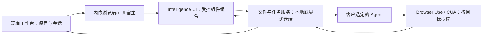

# 下一版：内嵌浏览器承载 Intelligence UI

更新：2026-10-14。**用户已确认澄白样式并授权开发；组件收敛为 7 类通用原子，正在实现真实接线。** 本文承接[能力扩展计划](capabilities.md)，不取消多 Agent、文件能力、Skill OS、极简 Loop、本机定时和默认隔离执行的既有要求。[调研](browser-and-intelligence-ui-research.md)保留证据与技术取舍，本页负责实施和验收。

## 给人阅读

### 范围已经纠正

**对话是唯一任务入口，Intelligence UI 按需出现在对话里，也能展开到浏览器式工作区。** 用户已授权重做旧工作台布局，取代固定侧栏任务表单。项目、会话、常用方法与定时仍然保留，连接和高级配置收进设置。

内置浏览器打开真实网页，交互 App 在隔离框架内渲染。它们共享当前工作和材料，但外部网页不能获得 App 的工具权限。展开和收起同一 App 不复制任务、草稿或 iframe；普通工作无需打开专门的“Intelligence UI”入口。

### 员工实际完成什么

客户使用自己的 Agent，在同一个工作台里选材料、核对表格和图片、打开业务网页、授权执行，再查看真实文件和业务回执。遇到系统弹窗或桌面软件时，可在获准的电脑环境继续。任务不因打开浏览器、展开交互界面或人工接管而变成另一份任务。

**黄金路径：**打开工作文件夹 → 在对话描述工作并添加材料 → 助手执行 → 对话内按需核对、补充或授权 → 打开真实成果 → 继续修改。表格、交互内容和网页可展开，仍属于原任务；不再打开第二套任务表单。

首条验收使用合成但结构真实的客服资料：Excel 订单、Word 沟通记录、PDF 售后政策和图片。员工核对表格、补充任务要求，再让 Agent 在自有测试网页填写处理建议、下载结果。没有真实订单系统时，只证明测试网页这条完整路径，不声称已经处理客户订单。普通本地任务不要求企业租户或云端登录。

### 已确认方向与本次纠正

本轮提交[容器内组件清单与样式](ui-components.md)：7 类可组合 UI 组件；另有 3 个宿主受控执行组件。组件数量不包含现有工作台导航和会话部件，也不代表要全部从头实现。用户已确认方向，按最新要求压缩原子组件并直接开发真实接线。

早期五版用于澄白样式选择。2026-10-14 用户否定固定侧栏表单与旧工作台信息层级，授权重做。当前实现必须以对话为主入口，连接和高级配置退到设置，交互按任务出现；展开/收起不得重载另一份状态。早期稿不再作为布局依据。

### 必须同时交付的能力

| 能力 | 用户可见的完成证据 |
| --- | --- |
| 内置浏览器 | 在现有工作台内部打开真实任务 UI 与网页，完成登录、上传、下载；明确项目、账号配置和操作方；关闭后可恢复同一任务 |
| Browser Use | 用户选定的 Agent 通过受控工具读取、点击和填写同一个目标；人能接管，停止后不继续自动输入 |
| CUA | 隔离环境默认可用；获准后也能操作本机应用；实际画面、输入、暂停、撤权和进程退出贯通 |
| Intelligence UI | 在对话中按任务组合注册组件，可展开到浏览器式区域；上传、编辑和提交得到持久化回执；结果真实回到原 Agent 和任务；两种尺寸复用同一实例和状态 |
| 文件与结果 | 上传范围可核对，原件不覆盖；下载校验后出现在项目；Excel、Word、PDF 可打开并核对内容和解析范围 |
| 多 Agent | 能力按实际适配器显示；不能连接工具的 Agent 明确不可用，不偷偷切换执行器或只给一个网页链接 |
| 资源与恢复 | 历史、网页、App 与执行环境按需启动；后台有上限，未保存工作受保护；断线和重开不重复业务写入 |

## 给 Agent 和开发者

### 实现边界与唯一责任方

容器负责挂载和生命周期，组件负责交互，Host/服务负责权限与业务状态。三者不能用一张页面的本地状态代替。执行器发现组件和工具后传入受校验描述；不是让模型生成任意 HTML、CSS、JS 或直接拿到 CDP。普通输入、筛选与选择立即在 UI 响应，不为每次点击启动模型。

| 责任方 | 负责 | 不负责 |
| --- | --- | --- |
| Electron 主进程 | `WebContentsView`、浏览器 profile、导航/窗口/下载策略、精确页面目标、生命周期 | 接受网页任意 IPC、把文件系统或凭据直接交给网页 |
| 私有 Host | 项目和任务、材料快照、授权、执行器工具注入、事件游标、持久化与恢复 | 把连接账号等同于允许操作所有资源 |
| Browser Use 工具入口 | 对当前获准页面执行，读回真实结果，检测接管与目标失效 | 独立推理系统、公共 CDP 端口、静默跨标签或跨客户执行 |
| ComputerRuntime | 复用隔离/本机 Cua 生命周期、桌面独占与紧急停止 | 在隔离启动失败后自动改用本机 |
| MCP Apps 宿主 | 资源读取、沙箱、AppBridge、工具调用/上下文更新、展开与卸载 | 用普通网页预览或前端日志冒充 Agent 回传 |
| 可选业务服务 | 资产、任务提交、幂等回执、结果权限与下载 | 依赖前端 CORS 或 UI 按钮判断业务授权 |

保留 Electron、React、私有 Node Host 与已有公司控件。手动浏览或使用 MCP App 不要求启动 VM；Agent 操作本机内置浏览器必须明确选择执行位置并授权。浏览器 profile、Chromium 沙箱、App 沙箱、隔离桌面是四种不同边界，UI 不把它们混称为“已隔离”。

### 真正接线的最短完整链路

1. 选定文件后由 Host 校验路径、类型、大小和权限，生成版本与摘要；上传以流传输，不把完整二进制/base64/签名 URL 放入对话或长期前端状态。远端上传只在用户选择服务并确认范围后发生。
2. App 的表格修改、照片选择和要求草稿绑定 `projectId + taskId + viewId`；展开、收起与刷新不复制另一份状态。工具资源保留协议需要的 `structuredContent`、资源与元数据，不能沿用仅文本的丢失式转换。
3. 提交绑定已核验 `assetId + version`、`requestId`、Agent 原生任务 ID 和授权。服务端检查身份与资源归属；重复请求返回同一任务。上传成功、任务受理、业务执行、成果保存分别记录。
4. Browser Use / CUA 调用绑定页面或桌面目标、项目、允许资源与有效期。页面跳转、窗口重建、授权撤销或人工接管后重新验证；不使用过期坐标或元素引用继续执行。
5. 回传保存 `eventId/cursor`、结果版本、文件校验、失败项与待确认动作。UI 显示持久化结果后通知**同一任务的当前 Agent**；通知失败可单独补交，不能重跑已提交的业务任务。
6. 断线、崩溃与取消后先查询原任务。状态未知显示“待核对”，不能报告失败后自动创建第二笔写入。部分完成保留成功与失败明细；成果校验失败不显示全部成功。

授权来源只能是用户或已有效的明确授权。网页、上传文件、Skill 文本和 App 消息都是不可信数据，不能扩大权限。外部 Agent 自带工具未受工作台完全控制时，必须如实说明。

### 开发顺序和退出条件

| 阶段 | 工作 | 进入下一阶段的证据 |
| --- | --- | --- |
| 0．设计评审（已选澄白） | 更新 Wiki/约束；确定组件职责；五版容器内部组件样式，覆盖资料、执行、授权、结果和恢复；对话为主入口 | 用户已确认方向；收敛为通用原子与声明式组装。评审演示不算产品实现 |
| 1．第一条真实路径 | 重做对话与材料入口，按需嵌入 MCP App 并支持同一内容展开；复用真实上传/任务服务；选一个实际支持工具的 Agent 完成上传→执行→结果回传 | 同一次任务的文件哈希、持久化记录、工具轨迹、可见 UI 与 Agent 收到结果一致；重开不重跑 |
| 2．浏览器和电脑接力 | 默认隔离环境可见操作、独占、暂停/接管/撤权；获准的本机浏览器和桌面路径；下载入项目 | 实际网页与桌面操作成功；目标变化、权限拒绝与停止均阻止后续输入；子进程可回收 |
| 3．完整工作台收口 | 多 Agent 能力矩阵；文件包、Skill/Loop、定时入口；长任务、错误恢复、客户账号配置和资源调度 | 对每个支持的执行器完成同类路径；不支持项真实标注；计划不绕过权限、不重复写入 |
| 4．跨平台发行 | Linux 主验证，macOS/Windows 可见交互；升级兼容；完整进程组和至少 8 小时后台测试 | 与版本绑定的实际证据、可恢复失败、数据兼容与发行检查通过，再按已有授权合入 main |

各阶段保持能运行的完整路径；不能先做所有设置页面，再以“接口已预留”结束。现有能力分支与 main 的差异在实施前重新核对；新文档不证明旧差异已合并。

### 内存和后台资源

资源配额集中在 Host 配置与调度中，区分默认值、平台探测和用户配置；不写死用户路径、系统临时目录、测试机地址或凭据。以下是首轮待实测的默认预算，不是已实现指标：

- 外部浏览器至多 2 个驻留页面，Intelligence UI 至多 1 个挂载视图；其余保留轻量标签元数据。重开会话不恢复全部页面。运行、待批准、上传和未保存编辑有保护引用；预算满时排队/提示，不能强杀丢工作，也不能无限突破上限。
- 同一桌面只有 1 个电脑操作任务；大型解析/转换进程最多并行 2 个。复用现有 Agent 会话回收规则，不按 Agent 种类各开一套预算。
- 表格、照片和历史按页或虚拟化；文件流传输；截图只保存必要的当前帧与有期限的调试证据。隐藏 DOM、iframe 和 WebContents 仍算驻留，关闭必须释放对应监听器与目标。
- 已关闭的页面、App、解析任务与隔离环境应在完成清理后回到无占用状态。不能恢复的外部网页表单先提示用户保存；已执行的业务写入不会因停止而撤销。
- 在 Linux 固定机器、固定负载先测冷启动和预热基线，登记 RSS/PSS、Chromium 子进程、Agent、解析器和 VM/容器开销。根据实际基线固定发行阈值后跑长测；不在失败后调高阈值来通过。macOS/Windows 分别记录其原生进程组指标，不能拿 Linux Host RSS 代替。

### 验收矩阵

主要自动化、真实协议和沙盒验证放在 `turnsu-dev-vps` 的隔离目录与测试数据中。不在个人 Mac 上反复安装，不改开发机已有服务。需要真实模型的用例单独标注账号、版本和费用范围；没有账号时不能用 fixture 冒充。

| 路径/风险 | 需要的真实证据 | 主环境 |
| --- | --- | --- |
| 文件→App→任务→Agent | 中文、多工作表、空单元格/公式、Word 表格/图片、文本/扫描 PDF；修改与来源；资产版本、任务回执、Agent 消息一致 | Linux 服务/真实工具；三平台可见 UI |
| 浏览器操作 | 页面加载/失败、登录、跨域跳转、弹窗、文件选择、上传取消、下载校验、人工接管与停止；只操作获准目标 | Linux 浏览器执行；macOS/Windows 系统交互 |
| App 协议与隔离 | `resources/read`、初始化、工具结果/元数据、上下文回传、重挂载；恶意消息、未授权域名/工具、过期 view/任务均拒绝 | Linux 协议/安全与桌面 UI |
| CUA | 隔离浏览器任务和获准本机应用；锁屏、权限拒绝、越界、接管、撤权、紧急停止、子进程退出 | Linux 隔离；macOS/Windows 本机 |
| 持久化与恢复 | 重复点击、断线后未知结果、上传完成但提交失败、业务完成但通知失败、应用崩溃；无重复写入且可单独补回执 | Linux 故障注入 + 真实存储 |
| 多 Agent | 逐个验证工具发现、实际调用、批准、停止、续跑和 UI 结果交接；Claude Code 真实测试继续暂缓 | Linux 优先，平台能力分别记录 |
| 资源 | 大量历史切换、连续开关页面/App、大文件、多个后台任务、8 小时运行；所有自有进程退出；不缓存全部历史/截图 | Linux 主长测；macOS/Windows 对照 |
| 跨平台发行 | 不同临时路径、含空格/中文路径、Windows 路径/文件锁；安装、升级、签名、输入法、缩放/键盘、系统文件框 | CI 三平台 + 实机证据 |

设计评审只验证布局和交互意图。接口存在、模拟数据、测试页面运行、无窗口 CI、提交应用审核，均不能单独证明客户版完整交付。README/Wiki 在每次开发后按真实完成状态更新。
